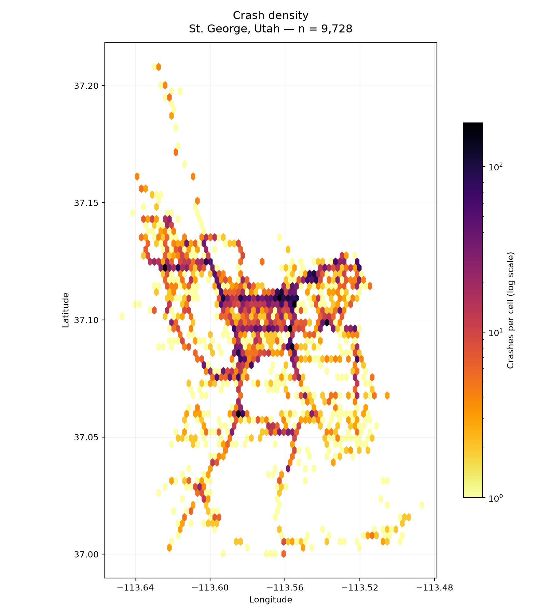
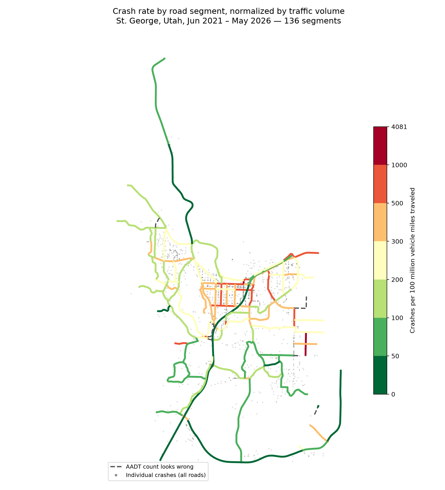
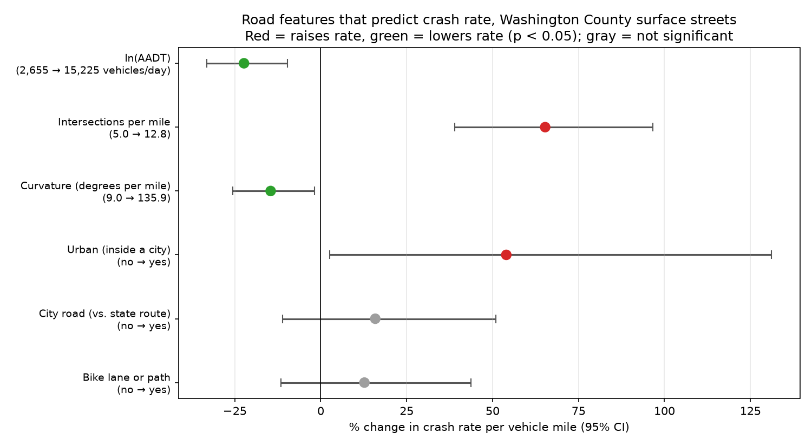
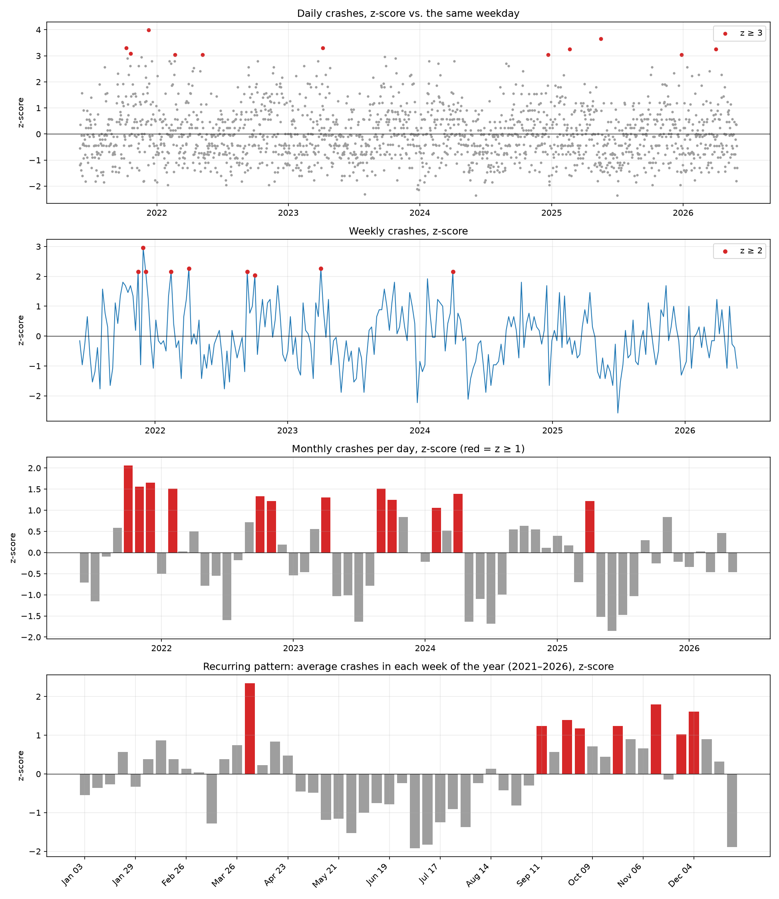

# St. George Car Accident Research

A data analysis of **9,728 car crashes in St. George, Utah (June 2021 – May 2026)** that looks for where, when and why crashes happen, and recommends fixes based on the FHWA's *Proven Safety Countermeasures*.

The project combines Utah crash records with statewide crash data (~300k crashes), UDOT traffic counts (AADT), UGRC road network data (Open SGID) and historical weather from Open-Meteo. Methods include traffic-normalized crash rates, the Highway Safety Manual's critical crash rate method, a negative binomial safety performance function, z-score time series analysis, and ML classifiers for serious and fatal crashes.

> 📝 The written report is still in progress.

<table>
  <tr>
    <td></td>
    <td></td>
  </tr>
  <tr>
    <td align="center"><b>Raw crash density.</b> Busy roads light up just because they carry the most traffic.</td>
    <td align="center"><b>Crash rate per 100M vehicle miles.</b> Normalizing by traffic shows which roads are actually riskier.</td>
  </tr>
</table>

## Key Findings

- **St. George isn't more dangerous than other Utah cities, but more of its crashes happen at intersections.** Its share of serious and fatal crashes (2.61%) matches other cities (2.50%, p = 0.52), but 34% of its crashes are at 4-way intersections (29% statewide) and 17% at T-intersections (9% statewide). Its 209 roundabout crashes included **zero** serious or fatal ones.
- **55 of 138 road segments are significantly more dangerous than similar roads** once traffic volume is accounted for. St. George Blvd (Main St to I-15) runs 2.5–3.8× its critical crash rate.
- **Intersection density is the strongest road-design predictor of crash rate.** Going from 5 to 13 intersections per mile raises the crash rate by **65%** (95% CI +39% to +97%) with traffic held constant.
- **Motorcycle and pedestrian crashes are 6–12× more likely to be serious or fatal.** Serious crashes are too rare (2.6%) for the decision tree, SVM and neural network models to predict reliably, but the risk factors stand out clearly.
- **Crashes follow a seasonal pattern.** The first week of April ran high in 4 of 5 years and September–December runs high every year, while storms cause the biggest single-day spikes.

<p align="center">
  
</p>

<p align="center">
  
</p>

## Project Structure

| Folder | What's in it |
| --- | --- |
| [`exploration/`](exploration) | First look at the data and the Open SGID connection |
| [`fatal_accident_research/`](fatal_accident_research) | Serious/fatal crash breakdown, and decision tree, SVM and neural network classifiers |
| [`statewide_comparison/`](statewide_comparison) | St. George vs. the rest of Utah (severity, junction types, chi-square tests) |
| [`normalized_crash_rates/`](normalized_crash_rates) | Crash rate per 100M vehicle miles for each road segment, critical rate flags, and crash profiles of the worst segments |
| [`road_feature_importance/`](road_feature_importance) | Negative binomial safety performance function relating road design to crash rate |
| [`map_visualization/`](map_visualization) | Static and interactive (Leaflet/Folium) crash heatmaps and crash rate maps |
| [`time_series_analysis/`](time_series_analysis) | Daily, weekly and monthly z-scores, per-road and per-intersection anomalies, temperature vs. crashes |
| [`report/`](report) | Draft write-up with recommendations |

The interactive maps in `map_visualization/*.html` are too large for GitHub to preview. Download one and open it in a browser to explore individual crashes.

## Running It

```bash
pip install -r requirements.txt
```

The raw crash data isn't included in this repo. Put the Utah crash exports and the UDOT AADT file in a `data/` folder at the repo root. `normalized_crash_rates/crashRates.py` builds the segment rate file that the map, road feature and intersection scripts depend on, so run it first.

## Tools

Python · pandas · GeoPandas · Shapely · statsmodels · scikit-learn · SciPy · Matplotlib · Folium · PostGIS (UGRC Open SGID)
